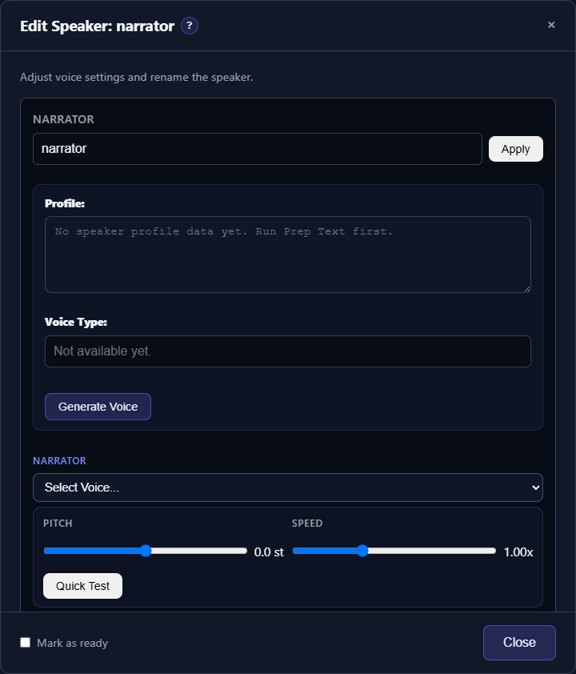

# Gemini TTS: Hosted Voices and Direction

Gemini TTS generates speech through Google's API. It is separate from the Gemini LLM provider used by Prep text: configure the **TTS API key** even if the LLM already works. TTS-Story offers Flash and Flash-Lite narration choices, subject to your account's model access and quota. Requests can be billable.

## Set up and assign voices

1. Open **Settings → Engines → Gemini TTS** and save the TTS API key.
2. Load the voice catalog and test the connection.
3. Choose a Gemini narration engine on the Generate page before assigning voices.
4. Open each speaker in the Cast list and select a Google preset or saved custom voice. Play its preview when available.
5. Save the project and generate a short passage before a full book.

*The shared Edit speaker drawer is where each character's voice is assigned; available voices depend on the selected engine.*

A local recording from the reference sample library is not interchangeable with a Google hosted custom voice. Use compatible voices shown for the selected engine; switching to a local cloning engine does not make a hosted voice ID into a local sample.

## Design and audition

Build or edit the speaker's Voice type and Voice design prompt, select **Gemini TTS** as the design engine, and generate candidates. Google supplies the audition wording for these designs; the local Preview text field does not control that hosted design preview. Select a candidate after listening, or discard the pending audition before making replacements. Pending candidates are saved for review rather than silently lost when the drawer closes.

For a whole cast, use **Generate voices** beside **Build profiles**. The Gemini design-model selector appears only when Gemini is selected as the design engine. Speakers marked **Ready** are skipped by default; an explicit **Include ready speakers** option is available. Pending auditions are retained without another generation request. Review cloud billing confirmations before proceeding.

## Hosted voice management and billing

Use **Available Voices → Gemini Custom Voices · Cloud** to search saved designs by name or ID, play their previews, and select several for deletion. Presets cannot be deleted. Removing a hosted voice leaves existing rendered audio unchanged, but projects that reference its ID need a replacement before future synthesis or regeneration.

Selecting an audition candidate offers to remove only the unselected candidates recorded in that audition. Cancelling keeps them. Closing without a selection preserves pending candidates; save the project for use in another browser. To replace an unwanted pending audition, choose **Generate Voice** again and confirm removal before billable replacement requests begin. Previously assigned voices from other auditions are not removed by this cleanup.

Up to four candidates per speaker are requested concurrently, subject to account quotas. Bulk casting processes speakers sequentially with pause/resume checkpoints and keeps successful candidates after partial failures. Retained pending auditions do not issue new design requests. Keep the page open while requests run and save after making selections. **Quick test** and regeneration are synthesis requests and may be billable; playing an already saved preview does not create a new voice.

A designed Google voice requires a Gemini narration engine. If another engine is selected, **Use voice** offers to switch the project's engine first; that affects all speakers, so review their assignments. Hosted IDs have provider-managed limits and expiry: consult [Google's Voice Design guide](https://ai.google.dev/gemini-api/docs/voice-design) before planning a large cast. Also review [current pricing](https://ai.google.dev/gemini-api/docs/pricing) and [API terms and data handling](https://ai.google.dev/gemini-api/terms) before submitting client manuscripts. A separate TTS key is not a separate Google billing project.

## Directed narration and repair

Bulk **Generate voices** assigns a single successful candidate directly to its speaker when Gemini narration is selected. Multiple candidates stay pending for you to choose. Existing unselected single auditions can be recovered through **Auto assign** without generating again; Auto assign only proposes custom Google voices and never substitutes a preset for a missing match.

Use the directed Strict Book Conversion prompts to keep delivery guidance in `[direction]...[/direction]` blocks rather than spoken text. Choose an appropriate stable Voice type for each speaker and restrained delivery guidance for narration. Review a short generated passage; extreme instructions can change the character of the delivery.

In Library → Review chunks, inspect the engine, voice, spoken text and Voice direction before regenerating. Regeneration makes a new synthesis request and can incur charges; playing a saved preview does not create a new voice.

## Troubleshooting

- **404 or unsupported engine after updating:** restart your own backend and reload the browser. Check that an older backend is not still serving the page.
- **Quota, authentication or model-access errors:** verify the TTS key, account access and billing separately from the Prep text LLM key.
- **A hosted audition fails:** inspect the provider error shown in the dialog. Keep successful pending candidates and retry deliberately; creating voices can be billable.
- **No preview for an existing selection:** not all preset/catalog entries include a stored preview. Use a short Quick test when needed, with awareness of possible synthesis charges.

See [Generate and Auto-Assign Voices](help:auto-assign-voices) and [Cloud Errors](help:cloud-errors).
