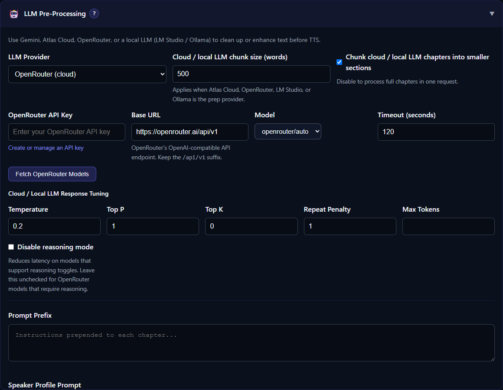

# Claude, Gemini, Atlas Cloud, and OpenRouter

TTS-Story supports four cloud providers for Prep text. Each provider requires internet access, sends manuscript sections outside your computer, and may charge for usage.

Open [Settings](app:settings), choose **Text prep (LLM)**, and select the **Primary provider** before entering its credentials.

## Build an ordered failover chain

The **Primary provider** is contacted first for every new operation. To add backups:

1. Configure the normal URL, API key, and model fields for every provider you intend to use.
2. Set **Backup profiles**. Increasing the number adds ordered profiles to the **Backup LLM profiles** card; reducing it removes cards from the end of the list.
3. Give each card a recognizable **Profile name**, such as `OpenRouter - Fast` or `Gemini - Secondary Key`.
4. Select that profile's **Provider**.
5. Enter a **Model override** when the profile should use a different model. Leave it blank to use that provider's normal model setting.
6. Enter an **API key override** when the profile needs its own credential. Leave it blank to inherit that provider's normal API key.
7. Set the **Daily request limit**. New profiles default to 18 requests; use `0` for unlimited requests.
8. Click **Save settings**.

Profiles are attempted from top to bottom. The same provider may appear more than once with different models or keys, so multiple OpenRouter routes or separate provider credentials can be placed at different points in the chain. Each profile is independent; an API-key override on one profile is not applied to another.

During multi-section Prep text, TTS-Story distinguishes temporary capacity problems from exhausted quota. High-demand, overloaded, timeout, connection, and temporary service errors use the existing five-retry cycle on the current profile before advancing. Explicit quota-exceeded or `RESOURCE_EXHAUSTED` responses advance to the next profile immediately. Invalid credentials, missing models, invalid prompts, and other configuration errors stop the operation so the setting that needs attention remains visible.

The daily request limit is a local safety control, not a provider billing guarantee. TTS-Story counts every request attempt made with that profile, including failed and retried requests, and resets its counter at midnight Pacific Time. It cannot see requests made by other applications. Limits belong to profiles, so reusing one API key in several profiles gives each profile a separate counter.

During a multi-section **Prep text** job, a successful backup remains active for the remaining sections. If it later fails, processing advances through the profiles after it. Pause and Resume preserve the active profile. Restart and every genuinely new operation begin with the primary again. **Build profiles** and a speaker's **Build profile** are separate operations, so each of those begins with the primary provider.

> **Quota note:** Creating several API keys does not necessarily create several independent quotas. For example, multiple Gemini keys in one Google project can still share that project's quota. Check the provider's current account and project limits.

*Choose the cloud provider first; TTS-Story then reveals its credentials, model discovery, and request controls.*

## Claude / Anthropic

Claude connects directly to Anthropic's native Messages API. It uses Console API credits, independently of Claude chat subscriptions and OpenRouter billing.

1. Select **Claude / Anthropic (cloud)** as Primary provider.
2. Enter your Claude Console API key. Leave Workspace ID blank for a workspace-scoped key; enter the workspace ID if your Console credential requires it.
3. Click **Fetch Claude models**, select an available model, and save settings. Discovery prefers a Sonnet model when no previous choice is available; it never silently substitutes a model during generation.
4. Try a short representative section before a whole book. Confirm the original text and speaker assignments are preserved.

Claude uses the shared non-Gemini chunk size and chapter splitting settings, but has its own timeout (300 seconds) and output ceiling (8,192 tokens). OpenAI/local sampling controls are not forwarded. Truncated, refused, or incomplete output is rejected rather than being accepted as a finished manuscript. Reduce the prep chunk size or raise Claude's output ceiling within the selected model's limits when necessary.

The API key is included in the existing secret-redaction rules for job snapshots. Like other provider keys, it is saved in local `config.json`. Backup profiles can also use Claude. Optional JSON schemas use native structured output and are validated locally; a model that does not support the requested schema must return an error rather than silently dropping it.

Reference: [Anthropic Messages API](https://platform.claude.com/docs/en/api/messages/create), [available models](https://platform.claude.com/docs/en/api/models/list).

## Gemini

Create and manage a key with the official [Gemini API key guide](https://ai.google.dev/gemini-api/docs/api-key).

1. Select **Gemini (cloud)**.
2. Enter the **Gemini API key**.
3. Click **Fetch models**.
4. Select an available model and click **Save settings**.

Gemini has its own chunk-size and chapter-chunking controls. The initial model list in the interface is only a fallback; **Fetch models** shows models available to the current key.

## Atlas Cloud

Review the official [Atlas Cloud model documentation](https://www.atlascloud.ai/docs/models/overview) before choosing a model or processing a long manuscript.

1. Select **Atlas Cloud (cloud)**.
2. Enter the **Atlas Cloud API key**.
3. Keep the default Base URL, `https://api.atlascloud.ai/v1`, unless Atlas instructs you to change it. Preserve the `/v1` suffix.
4. Click **Fetch Atlas models**.
5. Select a model and click **Save settings**.

The initial fallback model is `deepseek-v3`, and the default request timeout is 120 seconds. A fetched catalog is preferable to typing a model name because it reflects what the current service exposes.

## OpenRouter

Review [OpenRouter authentication](https://openrouter.ai/docs/api-reference/authentication) and create a restricted key for TTS-Story where possible.

1. Select **OpenRouter (cloud)**.
2. Enter the **OpenRouter API key**.
3. Keep the default Base URL, `https://openrouter.ai/api/v1`, unless OpenRouter instructs you otherwise.
4. Click **Fetch OpenRouter models**.
5. Select a model and click **Save settings**.

The initial fallback is `openrouter/auto`, and the default timeout is 120 seconds. OpenRouter models can have different prices, context limits, provider routing, and parameter support. Confirm the model and account policy before processing a full book.

## Shared cloud controls

Atlas Cloud and OpenRouter use the cloud/local **Chunk size** (words) and **Split chapters into smaller sections** settings shown for those providers, and the **Cloud / local LLM response tuning** card (Temperature, Top P, Top K, Repeat penalty, Max tokens, Disable reasoning mode).

Start conservatively:

- keep Temperature near the default 0.2 for faithful cleanup;
- leave Max tokens at 0 unless the chosen model needs an explicit limit;
- leave **Disable reasoning mode** off for OpenRouter models that require reasoning; and
- reduce chunk size if requests time out or truncate responses.

See [Prompt Presets, Chunking, and Review](help:llm-prompts) before changing several controls at once.

## Credential safety

API-key fields are obscured in the browser, but saved keys are stored as plain text in the local `config.json`. Do not share that file, attach it to an issue, or commit a populated copy. Use a restricted key where the provider offers restrictions, monitor account usage, and revoke a key immediately if it is exposed.

The repository ignores `config.json` so saved settings and API keys remain local and do not interfere with updates. This safeguard does not make the file safe to distribute manually. See [Local Data, API Keys, and Backups](help:data-storage).

## If model discovery fails

- Re-enter the key without leading or trailing spaces.
- Verify the Base URL and required suffix.
- Confirm internet access and provider status.
- Check account billing, quota, and model permissions.
- Increase the timeout only when the provider is responding slowly; it will not fix authentication.

If the primary works but a backup does not, test the provider settings inherited by that profile, then temporarily make the backup provider primary and run a small request. A blank override cannot compensate for a missing or invalid provider-level model or key.

For status-code guidance, open [Cloud Credentials, Quota, and Network Errors](help:cloud-errors).
