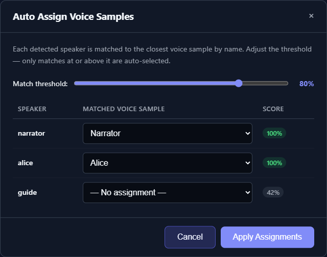

# Generate and Auto-Assign Voices

The Generate page offers two different automation tools. **Generate voices** designs new reference samples from speaker profiles. **Auto assign** matches detected speaker names to names already in the prompt library. Neither replaces listening to each assignment.

*Review every proposed name match and change any prompt selection before applying the assignments.*

## Generate voices from profiles

Speaker profiles can be created after a successful Prep text run, with **Build profiles** for all detected speakers, or individually: click the speaker in the **Cast** list and choose **Build profile** in its Edit speaker drawer. Only that speaker's bounded tagged excerpts are analyzed, and the manuscript is not rewritten. Review and edit the returned character profile and Voice type before using them.

To generate samples for all speakers:

1. Open [Generate](app:generate) and analyze the prepared text.
2. Confirm every detected speaker has a useful profile and voice type.
3. Click **Generate voices** beside **Build profiles** below the Cast list.
4. Under **Voice design engine**, choose **Qwen3-TTS**, **Breeze TTS 2**, or **Gemini TTS · Cloud Voice Design**.
5. Optionally enter a **Name prefix**, such as the book title, and set **Candidates per speaker**.
6. Review the speaker count, then click **Generate** and allow the sequential batch to finish.

Speakers marked **Ready** are skipped by Build profiles, Generate voices, and Auto assign by default. To deliberately prepare them again, enable **Include ready speakers in batch actions** below the Cast buttons, or **Include ready speakers** in the Generate voices dialog. A resumed generation batch keeps its original inclusion choice and rechecks ready flags before each remaining speaker.

Pending voice auditions are retained for selection rather than duplicated by a batch. Profile building preserves saved voice selections and auditions. If all speakers are ready, batch preparation makes no provider generation requests. Save the project to retain your ready flags and casting decisions.

For each speaker, TTS-Story uses the saved voice design prompt with the selected engine and generates the requested number of candidates. A single candidate is assigned automatically, including a hosted Gemini voice when a Gemini narration engine is selected. Multiple candidates remain available for review in that speaker's properties; TTS-Story does not arbitrarily choose between them. Partially failed auditions also remain for review. The completion message reports automatic assignments, retained auditions, and skipped ready speakers.

This operation can be slow and can consume significant GPU resources. Test one voice through [Voices → Voice creation](app:voices/qwen) before launching a large batch.

To build and design only one speaker, open it from the Cast list, click **Build profile**, review the fields, and then click **Generate voice** under **Design a new voice**. These buttons perform separate operations: Build profile calls the configured LLM chain, while Generate voice creates and saves the audio reference.

## Auto assign existing prompts

Auto assign compares each detected speaker tag name with saved prompt names using a text-name similarity score. It does not compare vocal sound and it does not semantically match the speaker profile.

With Gemini narration, Auto assign uses **custom hosted Gemini voices**, not local reference recordings or presets such as Iapetus. A single saved audition is matched to its own speaker by ID even when its name has a prefix. This can recover a previously generated, unassigned single voice without a new billable request. Multiple pending candidates require a deliberate choice. Unmatched Gemini speakers keep their current voice.

1. Analyze the manuscript so speakers are visible.
2. Ensure the desired reference prompts exist and have recognizable names.
3. Click **Auto assign** below the Cast list.
4. Adjust **Match threshold**; it starts at 80%.
5. Review every proposed prompt in the table.
6. Manually change or clear any dropdown.
7. Click **Apply assignments**.

A threshold only controls whether the best name match is preselected. The table still lets you choose any listed prompt. Naming a prompt `narrator`, `alice`, or `Book Name alice` consistently makes this workflow more predictable.

Auto assign populates reference-prompt assignments. It is not the right tool for engines that use only built-in voice catalogs, such as Kokoro, Azure, Edge TTS, or ElevenLabs; assign those voices manually.

## Verify the result

After either automation:

1. Open each speaker from the Cast list.
2. Confirm the selected engine and voice/prompt are compatible.
3. Play the raw prompt if available.
4. Click **Test** under **Quick test** with representative text.
5. Check language, transcript, speed, pitch, and silence controls.
6. Save a Project before making broad experiments.

Speaker “ready” state is only an organizational marker; it does not prevent generation with a missing or unsuitable assignment. The Generate action performs its own validation.

Continue with [Assign and Test Voices](help:assign-voices) or [Reference Voice Prompts](help:voice-prompts).
