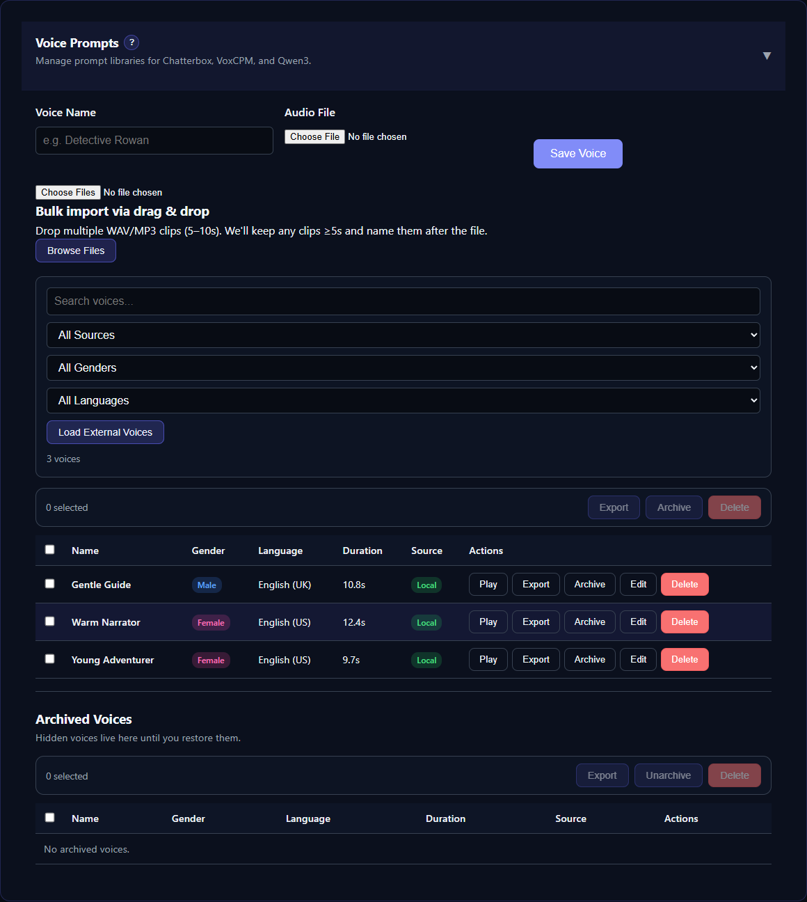

# Reference Voice Prompts

A voice prompt is a clean audio clip used by a cloning engine to guide voice identity and delivery. TTS-Story manages uploaded files and generated voice-design samples on the **Voice prompts** sub-tab of [Voices](app:voices/prompts).

*Use the prompt manager to upload clean references, verify metadata, preview clips, and maintain the reusable library.*

> The current interface uploads existing audio; it does not record from a microphone. Record and trim the clip in an audio editor, then upload it.

## Prepare a useful clip

For the most reusable prompt:

- use one speaker only;
- remove music, effects, room echo, and background voices;
- avoid clipping and aggressive noise reduction;
- keep a natural, steady delivery;
- include complete words at the beginning and end; and
- use a standard WAV, MP3, M4A, FLAC, or OGG file.

The manager recommends clips around 5–10 seconds. Chatterbox Turbo enforces a minimum of five seconds when saving through this page. Other engines have their own requirements; a longer clip is not automatically better.

Dot.TTS works best with the exact spoken transcript. A transcript is required before TTS-Story can synchronize a sample to a cloning-capable LocalAI model. VoxCPM and Qwen3 can use cached automatic transcription when a stored transcript is unavailable, but verify pronunciation with a short test rather than assuming transcription succeeded.

## Upload one clip

1. On the **Voice prompts** sub-tab, click **Add voice**.
2. Enter a friendly Voice name.
3. Choose an audio file.
4. Enter exactly what is spoken in **Exact transcript** when the sample may be used with LocalAI or another transcript-aware engine.
5. Click **Save voice**.

For bulk import, drag several supported clips onto the drop zone above the table or use **Browse files**. Filenames become friendly names, so rename source files before import if that saves cleanup.

Files are copied into `data/voice_prompts`; the originals are not linked in place.

## Organize the library

Use search and the source, gender, and language filters. Click a column header to sort the table. Edit metadata with the pencil icon to improve filtering or add a missing exact transcript. The **Transcript** column shows **Added** for samples that can be synchronized to LocalAI and **Missing** for samples without one; generated voice-design samples are backfilled from their saved preview text when possible. Metadata labels do not alter how the recording sounds.

First install the optional **Voice transcription** tool under [Settings → Engines → Utilities → Voice transcription](app:settings/transcription). Its install log shows the CPU dependency installation and pinned SenseVoiceSmall model download. It does not need a GPU, cloud key, or backend restart. Installing or repairing a TTS engine does not install this separate tool.

For a sample without text, open the row's **More actions** menu and select **Generate transcript**. You can also select several missing samples and use **Generate transcripts** in the selection bar that appears above the table. TTS-Story runs SenseVoice locally in a short-lived CPU worker, stores the detected text with the sample, and then marks it transcript-ready. The worker exits after each request, releasing its model. Review the generated transcript with the edit (pencil) icon, especially for names, invented words, acronyms, and noisy recordings.

If the runtime or model files are missing, install or repair **Voice transcription** in Settings. Do not install FunASR into the core application's virtual environment. You can always enter or correct a transcript manually. Removing the transcription tool keeps all saved voice samples and transcripts.

Each row has a play button, an edit icon, and a **More actions** menu with export, archive, and delete. Selecting rows shows a selection bar with the same actions for several voices at once. Archived voices remain stored in the collapsible **Archived voices** card and can be restored with **Unarchive**. Deleting removes the managed prompt and can break assignments that still reference its path.

**Load external voices** retrieves the current external GitHub catalog. Previewing requires internet access. Use an external voice's download icon, or **Download** in its **More actions** menu, to make a local prompt available to compatible engines; previewing alone does not add it to your prompts.

## Assign a prompt

1. Open [Generate](app:generate) and select a reference-based engine.
2. Let the text be analyzed and click the speaker in the **Cast** list.
3. In the **Edit speaker** drawer, choose the clip in **Voice Sample** (use the filter field above it for long lists).
4. If the engine needs a transcript, make sure the prompt has one (pencil icon on the **Voice prompts** sub-tab).
5. Click **Test** under **Quick test**. For reference engines this replays the clip with the selected pitch and speed.

The same prompt can behave differently across Chatterbox, VoxCPM, Pocket TTS, Qwen3, OmniVoice, IndexTTS, and Dot.TTS. Test it with the actual engine rather than relying on the raw clip preview.

See [Voice Management Overview](help:available-voices) and the selected article under [Engine Reference and Comparison](help:engine-overview).
